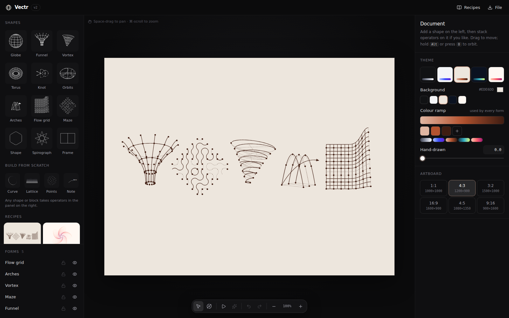

# Vectr

Compose generative vector art without the pen tool. Start from a simple source, stack
operators on it, and let depth and colour do the drawing. Export clean SVG.

**Live:** https://vectr-eight.vercel.app



## How it works

Every form is a small pipeline:

```
source                →  operators, applied top to bottom          →  style
curve · lattice ·        revolve · sweep · repeat · mirror · warp      weight and colour follow depth,
points · note · orbits   jitter · connect · tile · scatter · resample  hidden faces fade, fills, patterns,
card · context · strip   ticks                                         markers, labels
```

A circle revolved with an offset is a torus; add a twist warp and it corkscrews. A wave
repeated in depth with ribbon fills becomes strata. Points on a sphere, linked to their
nearest neighbours, become a constellation. An arc revolved and resampled into beads is
a globe; a circle with ticks is a dial. None of these are built in as fixed shapes;
they come from combining blocks.

- **8 sources, 11 operators**, each with its own settings, reorderable and toggleable.
  `orbits` lays rings on a shell at many tilts (orbits, gimbals, atoms), `card` is a
  caption panel with a frame, an icon and word-wrapped text, `ticks` hatches every line
  (dials, rulers, combs) with long marks every Nth tick, and `resample` in dots mode can
  keep its lines to string beads on them.
- **Context, as geometry**: the `context` source draws a context window as a field of
  token blocks (paste text and each word becomes a block, or generate tokens), with
  reading order as `t` and relevance as `family`, so a two-stop ramp by family lights up
  what was retrieved. `connect` mode "To a point" runs threads from the tokens to a chosen
  focus, which is attention: `split` fans them above and below. The Context window and
  Attention elements are ready-made.
- **Strips**: the `strip` source draws hyphenated ribbons: slabs joined by thinner necks,
  with a step or a ramp where they meet and square, slanted or round ends. Type a pattern
  (`#` a slab, `-` a neck, a space a gap), generate rows, or paste text and each word
  becomes a slab. Closed outlines fill solid; relevant slabs get their own outline in
  family 1, so a two-stop ramp by family picks them out, and `connect` mode "To a point"
  can thread from them. The Strip field and Linked mark elements are ready-made.
- **A signature style**: lines thin and lighten with depth, colour runs along an OKLab
  ramp (by depth, along the line, or per copy), back faces fade, optional ribbon fills
  between neighbouring lines and markers on points. Classic dotted or dashed hidden
  lines are still one setting away.
  - Lines can be solid, dotted or dashed (`dash`).
  - `fill` can paint closed shapes as well as ribbons, and `knockout` paints the
    background under the fill so forms beneath it are hidden.
  - Labels have a typeface (`labelFont`: mono, sans or serif), an optional colour
    (`labelColor`, which also colours card icons) and can run over several lines.
- **Mutate**: press `M` to see six variations of the selected form, click one to adopt
  it, and keep evolving. Subtle, medium or wild.
- **Elements**: ready-made pieces in the left panel (Globe, Dial, Orbit shell, Ruler,
  Caption, Gimbal, Gauge, Reticle, Contour). A form has a single line weight, so each
  element is several forms placed together, such as a heavy bezel over fine graduations.
  They scale with the artboard, name no colours and follow whatever theme is active.
- **Recipes**: twelve starting points (Pulse bloom, Strata, Constellation, Tidal field,
  Coil garden, Vessel, Meander, Loom knot, and the instrument plates Meridian,
  Gyroscope, Orrery and Sonar), all built from the same blocks.
- **Themes**: Graphite, Signal, Kiln, Ozone, Bloom, Fog. Each is a background plus a
  colour ramp, and the interface accent follows it.
- **Export and share**: SVG, SVG to clipboard, 2× PNG, project JSON, or a share link that
  holds the whole design in the URL. Vectr v1 files and links are converted on open.
- Undo and redo, autosave, spin animation, keyboard shortcuts, responsive layout.

## Shortcuts

| Key | Action |
| --- | --- |
| `V` / `O` | Move tool / Orbit tool (or hold `Alt` while dragging) |
| `Shift` + drag | Lock axis when moving; snap to 15° when orbiting |
| `M` | Mutate the selected form (then `1`–`6` to pick) |
| `P` | Play or pause spin |
| `⌘Z` / `⇧⌘Z` | Undo / redo |
| `⌘D` | Duplicate |
| `⌘S` / `⌘O` | Download SVG / open a project file |
| Arrows | Nudge (hold `Shift` for 10px) |
| `Space` + drag, scroll | Pan |
| `⌘` + scroll, `0` | Zoom / fit |

## For agents and scripts

### MCP server (Claude and other agents)

[`packages/mcp`](packages/mcp) is an MCP server. Run `npm run mcp` once, then start
Claude Code in this repo; `.mcp.json` registers it. Ask for something like *"a slow
constellation on a sphere over rippled terrain, ozone theme"* and Claude will compose
the stacks, check the previews, try a few mutations, and give you a link that opens the
result in the [live app](https://vectr-eight.vercel.app). It can also place the same
ready-made elements as the app (`add_elements`). See
[packages/mcp/README.md](packages/mcp/README.md) for setup and the tool list.

### Library and CLI

The engine lives in [`packages/core`](packages/core) (`@vectr/core`) and has no UI, so
scripts and agents run exactly what the app runs. A design is plain JSON; each form
needs only `source.kind`:

```bash
npm run build -w @vectr/core
echo '{"theme":"ozone","forms":[{"source":{"kind":"curve","params":{"shape":"circle","size":0.3}},
      "ops":[{"kind":"revolve","params":{"offset":0.7}},{"kind":"warp","params":{"kind":"twist"}}]}]}' \
  | npm run -s vectr -- render - -o torus.svg
npm run -s vectr -- link design.json      # link that opens it in the app
npm run -s vectr -- blocks                # every source, operator and style option, as JSON
```

Bad values are clamped or dropped, never fatal, and each fix is reported
(`warning: forms[0] (lattice): "rows" clamped to 2–60`) so an agent can correct itself.

## Develop

```bash
npm install
npm run dev      # http://localhost:5173
npm test         # engine, format, migration, MCP and CLI tests
npm run build
```

## Architecture

```
packages/core/src/
  sources/      curve (15 shapes), lattice, points, note, orbits, card, context, strip → polylines with t / family / band
  operators/    pure (geometry, params) → geometry functions, each with a param schema
  pipeline.ts   source → enabled ops, cached, with a point budget so any stack stays fast
  render.ts     project, split visible/hidden, bucket segments by depth and colour
  svg.ts        buckets → SVG (the canvas and every export use this)
  schema.ts     validate and normalise untrusted designs; migrate.ts converts v1
  mutate.ts     seeded variations of a form
  elements.ts   ready-made multi-form pieces, placed for any artboard size
  recipes.ts    starting designs; themes.ts holds the backgrounds and ramps
  share.ts      share links (compact JSON → deflate → base64url)
packages/mcp/   MCP server for agents
src/            the React app: canvas, pipeline inspector, Mutate, store (undo + autosave)
```

To add an operator, write one `OpDef` (a param schema plus `apply`) and register it in
`packages/core/src/operators/index.ts`. The inspector, validation, MCP descriptions and
Mutate all read its schema, so you don't need to write any UI code for it.
